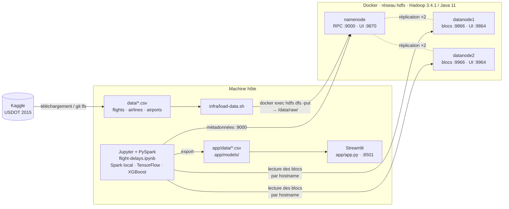

# Projet Hadoop - Prédiction retard vol

**Dataset** : [USDOT 2015 Flight Delays and Cancellations (Kaggle)](https://www.kaggle.com/datasets/usdot/flight-delays), soit 5 819 079 vols × 31 colonnes.

**Objectif** : prédire si un vol arrivera avec **plus de 15 min de retard** (définition du BTS), uniquement à partir d'informations connues avant le départ : compagnie, aéroports, date, heure, durée et distance prévues.

**Pipeline** : CSV → HDFS (Docker) → notebook PySpark (exploration, nettoyage, 4 modèles) → fichiers exportés dans `app/` → application Streamlit.

## Infrastructure



### Cluster HDFS (`infra/`)

| Conteneur | Rôle | Ports publiés sur `127.0.0.1` | Volume |
|---|---|---|---|
| `namenode` | métadonnées du système de fichiers | `9000` (RPC HDFS), `9870` (interface web) | `namenode` |
| `datanode1` | stockage des blocs | `9866` (transfert de blocs), `9864` (web) | `datanode1` |
| `datanode2` | stockage des blocs | `9966` (transfert de blocs), `9964` (web) | `datanode2` |

- **Image** : construite depuis `infra/Dockerfile`, Ubuntu 24.04 avec Hadoop 3.4.1 et Java 11. Les 3 conteneurs partagent la même image et se distinguent par leur commande (`namenode` ou `datanode`).
- **Configuration** (`infra/conf/`) :
  - `fs.defaultFS=hdfs://namenode:9000` ;
  - `dfs.replication=2`, donc chaque bloc est présent sur les 2 DataNodes ;
  - permissions désactivées (environnement de développement).
- **Démarrage** :
  - le NameNode ne se formate que si son volume est vide (`infra/entrypoint.sh`) ;
  - les DataNodes attendent que le NameNode soit en bonne santé (healthcheck sur l'interface web) ;
  - `docker compose down -v` remet HDFS à zéro.
- **Accès depuis la machine hôte** : Spark tourne en dehors de Docker. Le NameNode lui renvoie les noms d'hôte des DataNodes (`datanode1`, `datanode2`). Chaque DataNode a donc son propre port de transfert, publié tel quel (9866 et 9966, passés en `-D` dans `docker-compose.yml`), et la machine hôte doit résoudre ces noms. D'où :
  - la ligne `127.0.0.1 namenode datanode1 datanode2` dans `/etc/hosts` ;
  - `spark.hadoop.dfs.client.use.datanode.hostname=true` dans la session Spark.

### Côté machine hôte

- **Jupyter / PySpark** : Spark tourne en mode local, sur tous les cœurs, avec 6 Go de mémoire pour le driver. Il lit `hdfs://localhost:9000/data/raw/flights.csv`, puis entraîne les modèles avec Spark MLlib, TensorFlow et XGBoost.
- **Streamlit** : l'app **ne se connecte pas à HDFS**. Elle lit les fichiers exportés dans `app/data/` et `app/models/`. Elle démarre seulement un petit Spark local (sans interface) pour charger le Random Forest Spark.

## Lancer le projet depuis le début

### 0. Prérequis

| Outil | Version | Pourquoi |
|---|---|---|
| Docker (Desktop) | récent | cluster HDFS : 1 NameNode + 2 DataNodes |
| [uv](https://docs.astral.sh/uv/) | récent | environnement Python **3.11** (imposé par `pyproject.toml`) |
| Java | **17 ou 21** | Spark tourne sur la JVM. Java 23+ plante (`getSubject is not supported`) |
| Git LFS | récent | `data/flights.csv` (≈ 590 Mo) est stocké avec LFS |
| `libomp` (macOS seulement) | - | requis par XGBoost : `brew install libomp` |

Vérifier que `java -version` affiche 17 ou 21. Sinon, définir `JAVA_HOME` (par ex. `export JAVA_HOME=/opt/homebrew/opt/openjdk@17` sur macOS avec Homebrew).

### 1. Récupérer le code et les données

```bash
git clone <url-du-repo> && cd DelayFlightPrediction
git lfs install && git lfs pull      # télécharge data/flights.csv
ls data/                             # flights.csv, airlines.csv, airports.csv
```

Sans LFS, télécharger le dataset Kaggle et dézipper les 3 CSV dans `data/`.

### 2. Installer l'environnement Python

```bash
uv sync
```

Ou, sans uv : `pip install -r requirements.txt` dans un environnement Python 3.11.

### 3. Rendre les DataNodes joignables depuis la machine

Spark tourne sur la machine hôte et doit contacter chaque DataNode par son nom. Ajouter une fois cette ligne à `/etc/hosts` :

```bash
echo "127.0.0.1 namenode datanode1 datanode2" | sudo tee -a /etc/hosts
```

### 4. Démarrer HDFS et y charger les données

```bash
cd infra && docker compose up -d --build && cd ..
./infra/load-data.sh     # attend les 2 DataNodes puis envoie les 3 CSV dans hdfs:///data/raw/
```

Vérification : l'interface du NameNode sur http://localhost:9870 (onglet *Datanodes* : 2 nœuds actifs ; *Utilities → Browse* : `/data/raw`).

### 5. Exécuter le notebook (entraînement et export)

Le notebook de référence est **`notebooks/flight-delays.ipynb`**. Il produit tout ce que l'application lit.

```bash
uv run jupyter lab
```

Ouvrir `notebooks/flight-delays.ipynb`, puis *Run → Run All Cells*. Il faut compter **environ 5 min** sur un portable 8 cœurs / 16 Go.

Ou bien sans interface :

```bash
cd notebooks
uv run jupyter nbconvert --to notebook --execute --inplace --ExecutePreprocessor.timeout=-1 flight-delays.ipynb
cd ..
```

Étapes du notebook :
1. Lecture de `flights.csv` depuis HDFS, conversion des types.
2. Exploration : valeurs manquantes, cardinalités, distribution de la cible, corrélations.
3. Nettoyage :
   - suppression des vols annulés ou déroutés, des doublons et des codes aéroport numériques ;
   - suppression des retards hors de [-120, 1500] min.
   - Il reste 5 231 110 vols.
4. Features : heure de départ, label `ARRIVAL_DELAY > 15`, encodage des catégories.
5. Entraînement :
   - échantillon de 15 % (variable d'environnement `SAMPLE_FRACTION`), découpé en 70 % train / 10 % validation / 20 % test ;
   - le seuil de décision est choisi sur la validation ;
   - 4 modèles :

   | Modèle | AUC test |
   |---|---|
   | XGBoost | 0,724 |
   | Réseau de neurones MLP (TensorFlow) | 0,677 |
   | Random Forest (Spark MLlib) | 0,665 |
   | Régression logistique (TensorFlow) | 0,636 |

6. Export vers `app/data/` (statistiques, routes, scores, courbes de seuil, corrélations) et `app/models/` (les 4 modèles et `preprocessing.json`).

Les modèles et les données exportées sont versionnés dans `app/`. Si on veut seulement l'application, on peut passer les étapes 3 à 5.

### 6. Lancer l'application Streamlit

Depuis la racine du repo :

```bash
uv run streamlit run app/app.py
```

L'application s'ouvre sur http://localhost:8501 :
- **Prédire un retard** : on choisit le départ, l'arrivée (seulement les destinations desservies), la compagnie (seulement celles qui font la route), la date et l'heure. On obtient la probabilité de retard selon les 4 modèles. La durée et la distance sont déduites de la route.
- **Explorer les retards** : taux et retard moyen par compagnie, heure et mois, avec des filtres.
- **Le modèle** : les scores, l'effet du seuil de décision et la matrice de corrélation.

Le premier chargement de la page de prédiction prend environ 10 s : elle démarre un Spark local pour lire le Random Forest. Java doit donc être disponible.

### 7. Arrêter

Depuis `infra/`, l'une ou l'autre :

```bash
docker compose down        # garde les données HDFS
docker compose down -v     # efface aussi HDFS (le NameNode se reformate au prochain démarrage)
```

## Dépannage

| Symptôme | Cause / solution |
|---|---|
| `getSubject is not supported` au démarrage de Spark | Java 23+ : passer à Java 17 ou 21 (`JAVA_HOME`) |
| Spark bloque ou échoue en lisant HDFS (`Connection refused`, `UnknownHost datanode1`) | ligne `/etc/hosts` manquante (étape 3), ou cluster pas démarré |
| `Library not loaded: libomp.dylib` (XGBoost) | macOS : `brew install libomp` |
| `OutOfMemoryError: Java heap space` pendant le Random Forest | fermer les autres notebooks Spark ouverts. La session demande 6 Go (`spark.driver.memory`) |
| Le noyau Jupyter meurt pendant la préparation des données | baisser l'échantillon : `SAMPLE_FRACTION=0.05 uv run jupyter lab` |
| L'application affiche « Fichiers manquants » | relancer le notebook jusqu'à la section 6 (export) |

## Structure

```
data/                 dataset Kaggle (flights.csv en LFS, airlines.csv, airports.csv)
infra/                Docker Compose HDFS (Hadoop 3.4.1) + script de chargement
notebooks/
  flight-delays.ipynb notebook unique : EDA → nettoyage → 4 modèles → export
app/
  app.py              point d'entrée Streamlit (navigation)
  pages/              predict.py, explore.py, model.py
  data/               CSV exportés par le notebook
  models/             modèles entraînés + preprocessing.json
```
